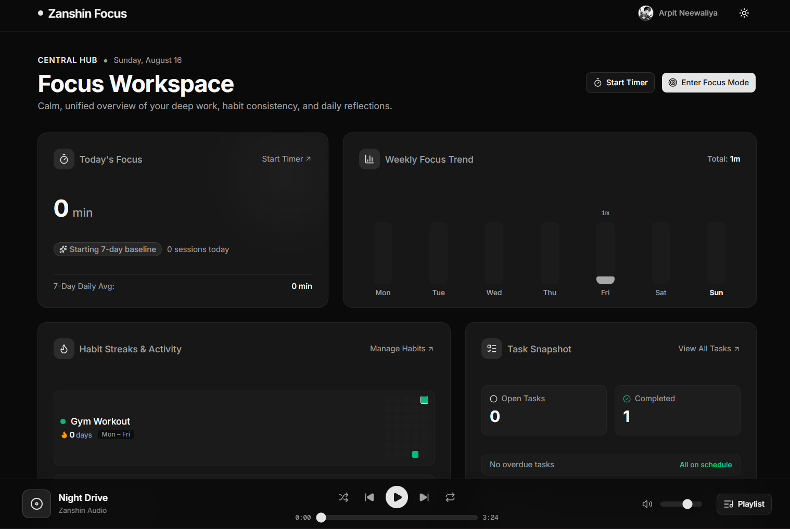
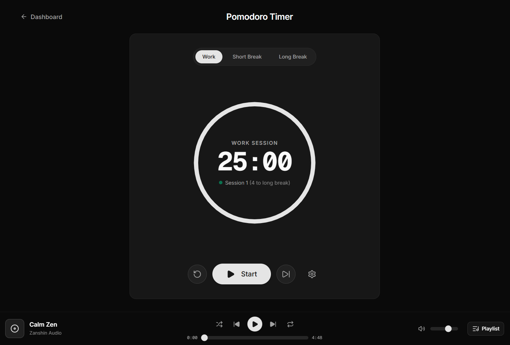
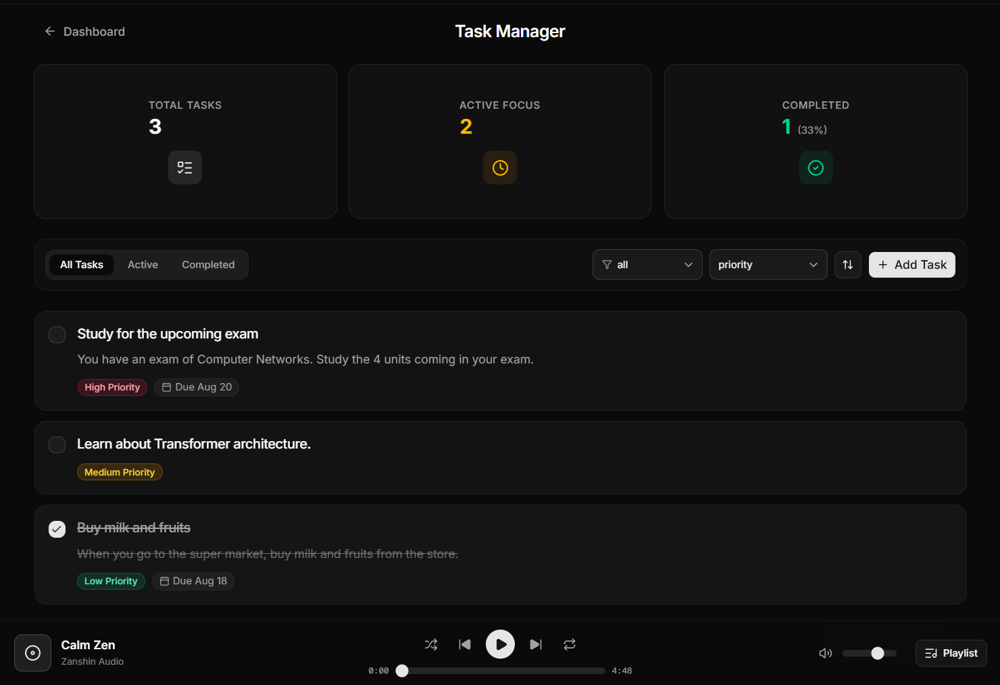
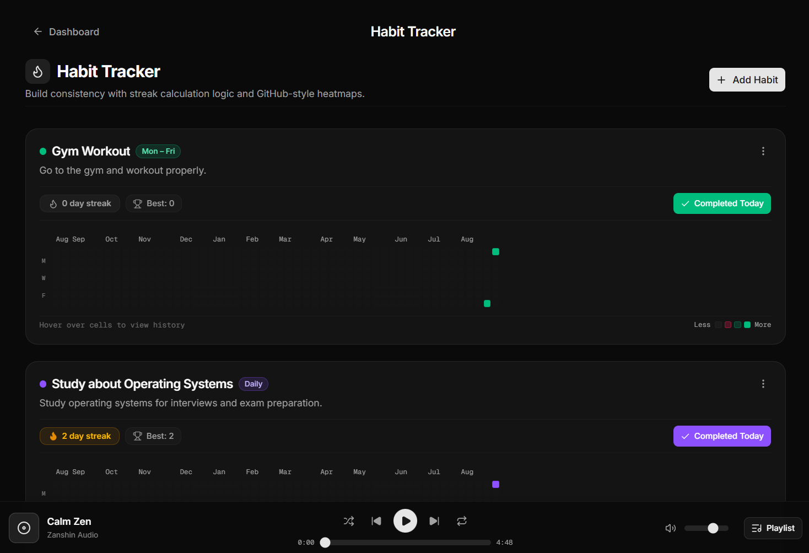
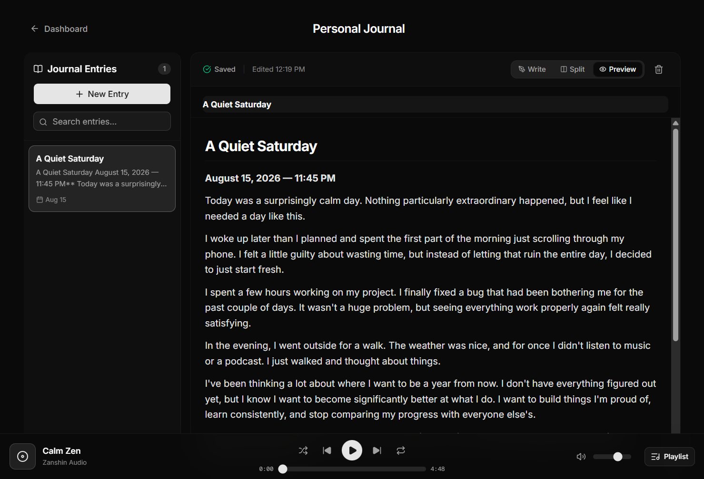
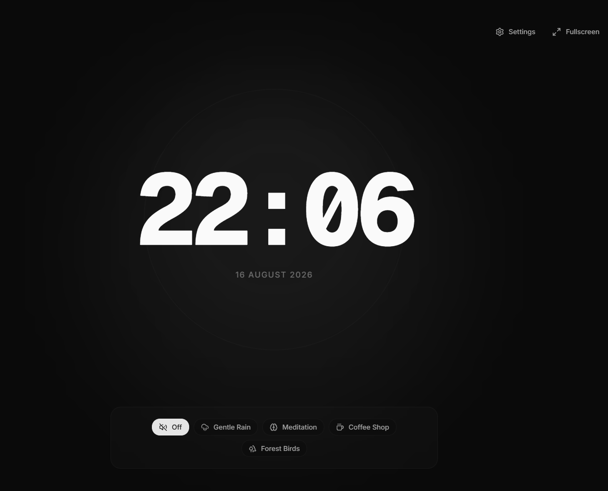
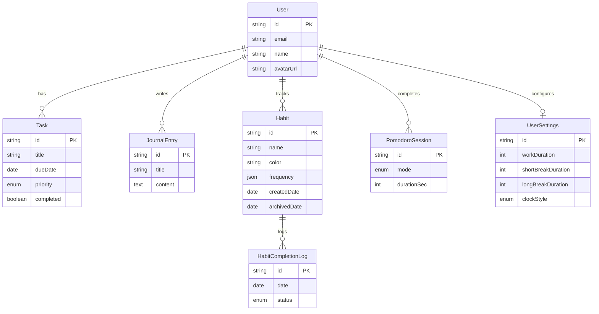

<div align="center">

# Zanshin Focus

**One calm workspace for deep work: Pomodoro timer, tasks, habits, journal, and an immersive focus mode.**

[Live Demo](https://zanshin-focus-app.vercel.app) · [Report a Bug](https://github.com/arpitneewaliya/zanshin-focus-app/issues) · [Request a Feature](https://github.com/arpitneewaliya/zanshin-focus-app/issues)


</div>

---

## Table of Contents

- [About](#about)
- [Features](#features)
- [Screenshots](#screenshots)
- [Tech Stack](#tech-stack)
- [Architecture](#architecture)
- [Getting Started](#getting-started)
- [Database Schema](#database-schema)
- [Deployment](#deployment)
- [Scripts](#scripts)
- [Roadmap](#roadmap)
- [Contributing](#contributing)
- [License](#license)
- [Author](#author)

---

## About

Most productivity setups are a pile of disconnected tools: a timer here, a to-do app there, a habit tracker, a notes app. Every switch between them is a micro-distraction.

**Zanshin Focus** brings the essentials into one minimalist, distraction-free interface:

- ⏱️ A Pomodoro timer
- ✅ A task manager
- 🔥 A habit tracker with heatmaps
- 📓 A Markdown journal
- 🎧 A full-screen focus mode with ambient sound

> **Why "Zanshin"?** 残心 (*zanshin*) is a martial arts concept meaning relaxed, sustained awareness before, during, and after an action. The app is built around that idea: calm, present, and unhurried, rather than hijacking your attention.

**Who is it for?** Students, developers, writers, freelancers, and remote workers who want one quiet place to plan, focus, and reflect.

---

## Features

### ⏱️ Pomodoro Timer
- Customizable work, short break, and long break durations, plus a long-break interval
- Animated SVG progress ring and live countdown in the browser tab title
- Completion chime (synthesized in-browser, no asset required) and browser notifications
- Completed sessions are logged to the database and feed the dashboard stats
- Settings sync across devices for signed-in users

### ✅ Task Manager
- Create, edit, delete, and complete tasks with descriptions, due dates, and priorities
- Filter by status and priority, sort by created date, due date, or priority
- Overdue and due-today indicators
- Optimistic UI updates with automatic rollback if the server call fails
- One-click "clear completed"

### 🔥 Habit Tracker
- Three schedules: **every day**, **specific weekdays**, or **N times per week**
- **Honest streak logic**: streaks count consecutive *scheduled* occurrences, so rest days never break your streak
- Current and longest streak per habit
- A GitHub-style **52-week heatmap per habit**, using the habit's own color
- Tri-state check-in: none → completed → missed → none
- **Archive** a habit (keeps its history) or **delete** it permanently (with confirmation)

### 📓 Personal Journal
- Markdown editor with **Write**, **Split**, and **Preview** modes
- Debounced autosave with save-status indicator, and a flush on unmount so edits aren't lost
- Full-text search across titles and content
- Auto-derived titles from the first line when you don't set one
- Responsive layout with a mobile sidebar/editor switcher

### 🎯 Focus Mode
- Full-screen "sanctuary" with a breathing ambient glow
- Four clock styles: **Digital**, **Minimal**, **Analog**, and **Text** (time in words)
- 12/24-hour format, optional seconds, optional date
- Ambient soundscapes: rain, meditation, coffee shop, forest, with volume and mute
- Controls auto-hide after inactivity; press `Esc` to exit and see a session summary

### 📊 Dashboard
- Today's focus minutes compared to your 7-day average
- 7-day focus bar chart
- Habit streaks with compact mini-heatmaps
- Task snapshot: open, completed, overdue, completion rate
- Latest journal entry and weekly writing activity

### And more
- 🎵 Persistent global music player with playlist, shuffle, repeat, and volume
- 🌗 Light and dark themes (follows your system by default)
- 🔐 Email/password and Google sign-in via Supabase Auth
- 👤 Profile and settings: display name, avatar upload, email change, timer and focus preferences
- 📱 Responsive across mobile, tablet, and desktop
- ♿ Keyboard-navigable with ARIA labels on interactive controls

---

## Screenshots

> Screenshots live in [`public/images`](./public/images).

| Dashboard | Timer |
| :---: | :---: |
|  |  |

| Tasks | Habits |
| :---: | :---: |
|  |  |

| Journal | Focus Mode |
| :---: | :---: |
|  |  |

Light-mode variants are available as `*-preview-light.png` in the same folder.

---

## Tech Stack

| Layer | Choice | Notes |
| --- | --- | --- |
| Framework | [Next.js 16](https://nextjs.org) (App Router) | Server Components + Server Actions |
| Language | TypeScript (strict) | |
| UI | React 19 | |
| Styling | [Tailwind CSS v4](https://tailwindcss.com) | CSS-variable theming (oklch) |
| Components | [shadcn/ui](https://ui.shadcn.com) on [Base UI](https://base-ui.com) | Single component library, no others |
| State | [Zustand](https://zustand-demo.pmnd.rs) | Client state and optimistic updates |
| Animation | [Motion](https://motion.dev) | Imported from `motion/react` |
| Icons | [Lucide](https://lucide.dev) | |
| Markdown | [react-markdown](https://github.com/remarkjs/react-markdown) | Journal preview |
| Audio | [Howler.js](https://howlerjs.com) | Ambient sounds, music player, timer chime |
| Auth | [Supabase Auth](https://supabase.com/auth) | Email + Google OAuth |
| Database | PostgreSQL (Supabase) | |
| ORM | [Prisma 6](https://www.prisma.io) | Single data-access layer |
| Storage | Supabase Storage | Avatar uploads |
| Hosting | [Vercel](https://vercel.com) | Plus Vercel Analytics |

---

## Architecture

### Folder structure

```
├── app/                  # App Router routes, layouts, loading states
│   ├── actions/          # Server Actions (tasks, habits, journal, pomodoro, account, dashboard)
│   ├── auth/callback/    # OAuth code-exchange route handler
│   ├── (auth)/           # Login and signup pages
│   └── dashboard, timer, tasks, habit-tracker, journal, focus-mode, settings/
├── components/           # Shared UI (shadcn/ui primitives, theme, user menu)
├── features/             # One folder per feature (components, types, utils, hooks)
│   ├── timer/  tasks/  habit-tracker/  journal/
│   ├── focus-mode/  dashboard/  music-player/
│   └── auth/  settings/  landing/
├── stores/               # Zustand stores
├── lib/                  # Prisma client, Supabase clients, sound utilities
├── prisma/               # schema.prisma and migrations
├── public/               # Images, ambient sounds, music tracks
└── middleware.ts         # Session refresh + route protection
```

### Key design decisions

- **Server Actions instead of an API layer.** All reads and writes go through typed Server Actions that return a consistent `{ success, data, error }` result. There is no tRPC or REST layer.
- **Prisma is the single data layer.** Supabase is used for **auth and file storage only**. App data is never queried through `supabase-js`.
- **Auth in middleware.** `middleware.ts` refreshes the Supabase session on every request, redirects unauthenticated users away from protected routes, and sends signed-in users from `/`, `/login`, and `/signup` to `/dashboard`.
- **Ownership checks on every mutation.** Server Actions verify the user and scope queries by `userId`, so users can only touch their own data.
- **Optimistic updates with rollback.** Tasks, habits, and check-ins update the UI immediately and revert with an error banner if the server call fails.
- **Debounced persistence.** Settings and journal edits are saved on a debounce and flushed on unmount.
- **Scheduled-occurrence streaks.** Habit streak logic lives in `features/habit-tracker/utils.ts` and is shared by the tracker and the dashboard.

---

## Getting Started

### Prerequisites

- **Node.js 22+** and npm
- A free [Supabase](https://supabase.com) project

### 1. Clone and install

```bash
git clone https://github.com/arpitneewaliya/zanshin-focus-app.git
cd zanshin-focus-app
npm install
```

### 2. Configure environment variables

Create a `.env` file in the project root:

```env
# Supabase (Project Settings → API)
NEXT_PUBLIC_SUPABASE_URL=https://your-project.supabase.co
NEXT_PUBLIC_SUPABASE_ANON_KEY=your-anon-key

# Postgres (Project Settings → Database → Connection string)
DATABASE_URL=postgresql://...   # pooled connection (used by the app)
DIRECT_URL=postgresql://...     # direct connection (used by Prisma migrations)
```

> ⚠️ Never commit `.env`. It's already in `.gitignore`.

### 3. Set up Supabase

<details>
<summary><b>Auth and storage setup</b></summary>

1. **Email auth**: enabled by default in Supabase.
2. **Google OAuth** (optional): enable it under *Authentication → Providers → Google* and add your Google client ID and secret.
3. **Redirect URLs**: under *Authentication → URL Configuration*, add:
   - `http://localhost:3000/auth/callback`
   - `https://your-production-domain/auth/callback`
4. **Avatar storage**: create a **public** storage bucket named `avatars` (used by profile pictures).

</details>

### 4. Set up the database

```bash
npx prisma migrate deploy   # apply migrations
npx prisma generate         # generate the Prisma client
```

### 5. Add audio assets

Audio files are not bundled with the source. Add your own (or royalty-free) files at these paths:

<details>
<summary><b>Expected audio files</b></summary>

**Focus Mode ambient sounds** (`public/sounds/`):
- `rain.wav`
- `meditation.mp3`
- `cafe.wav`
- `forest.wav`

**Music player tracks** (`public/audio/music/`), referenced in `features/music-player/data/tracks.ts`:
- `calm-zen.mp3`, `chillhop-study.mp3`, `christmas-music.mp3`, `coffee-shop-jazz.mp3`, `focus.mp3`
- `lofi-rain-night.mp3`, `lofi-relax.mp3`, `lofi-study.mp3`, `motivation.mp3`, `night-drive.mp3`

Edit `tracks.ts` and `features/focus-mode/types.ts` to match whatever files you use. The timer chime is generated in code and needs no asset.

</details>

### 6. Run the app

```bash
npm run dev
```

Open [http://localhost:3000](http://localhost:3000).

---

## Database Schema

Managed with Prisma (`prisma/schema.prisma`). User IDs match Supabase Auth user IDs.



- Deleting a user cascades to all of their data.
- `HabitCompletionLog` has a unique constraint on `(habitId, date)`: one log per habit per day.
- `Habit.frequency` is JSON: `{ "type": "daily" }`, `{ "type": "weekdays", "daysOfWeek": [1,3,5] }`, or `{ "type": "weekly_target", "targetDaysPerWeek": 5 }`.

---

## Deployment

The app is designed for [Vercel](https://vercel.com):

1. Push the repo to GitHub and import it in Vercel.
2. Add the four environment variables from [Getting Started](#2-configure-environment-variables).
3. In Supabase, add your production URL's `/auth/callback` to the allowed redirect URLs.
4. Run `npx prisma migrate deploy` against your production database.
5. Deploy.

`vercel.json` pins the deployment region to `bom1` (Mumbai). Change it to the region closest to your Supabase project for the lowest latency.

---

## Scripts

| Command | Description |
| --- | --- |
| `npm run dev` | Start the development server |
| `npm run build` | Create a production build |
| `npm run start` | Run the production build |
| `npm run lint` | Lint with ESLint |

---

## Roadmap

- [ ] Offline-first sync
- [ ] Richer browser notifications for tasks and habits
- [ ] GitHub Actions CI/CD
- [ ] Persist music player preferences (volume, repeat, shuffle) per user across devices
- [ ] Layered ambient sound mixing in Focus Mode
- [ ] Tests (unit tests for streak logic, E2E for core flows)

---

## Contributing

Contributions, issues, and feature requests are welcome.

1. Fork the repository
2. Create a branch: `git checkout -b feature/your-feature`
3. Make your changes and run `npm run lint`
4. Commit: `git commit -m "Add your feature"`
5. Push and open a Pull Request

**Project conventions:**

- Use **shadcn/ui** and **Tailwind** for UI; don't add other component libraries
- Use **Lucide** for icons and **Motion** (`motion/react`) for animation
- Access data through **Prisma** via **Server Actions**
- Keep components small and colocated in their `features/` folder
- Keep TypeScript strict, and never commit secrets

---

## Author

**Arpit Neewaliya**

- X (Twitter): [@arpitneewaliya](https://x.com/arpitneewaliya)
- GitHub: [@arpitneewaliya](https://github.com/arpitneewaliya)

If you find this project useful, consider giving it a ⭐.
